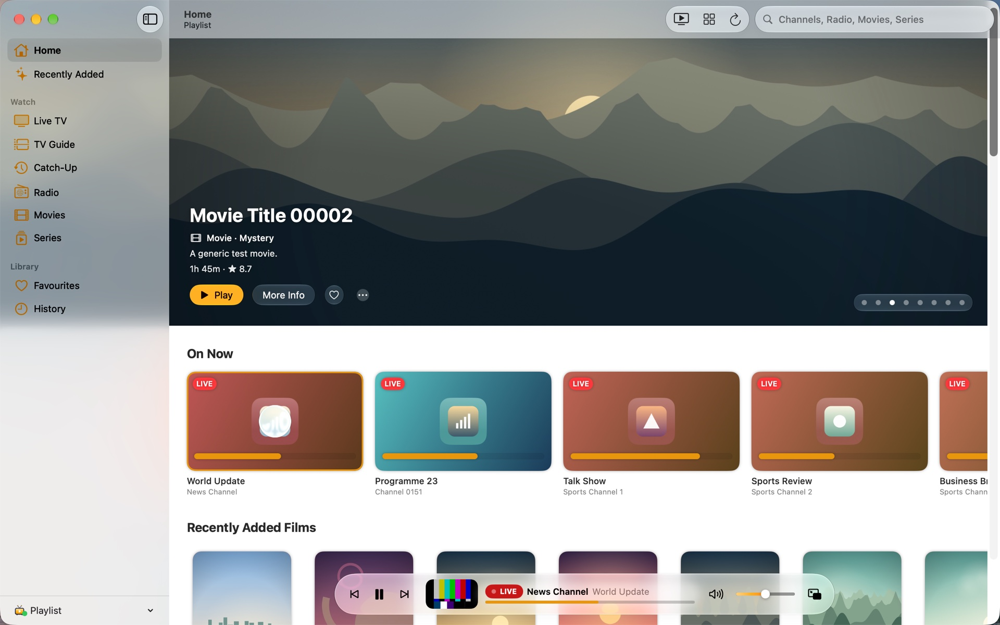
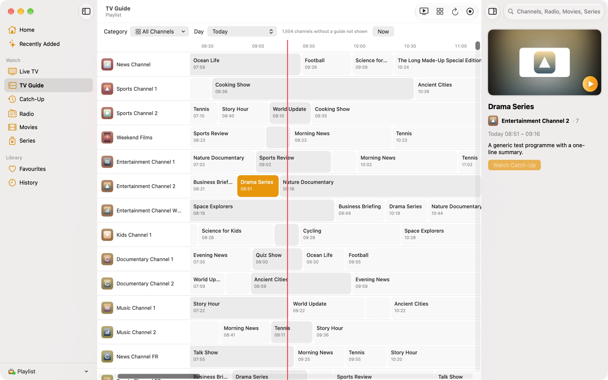
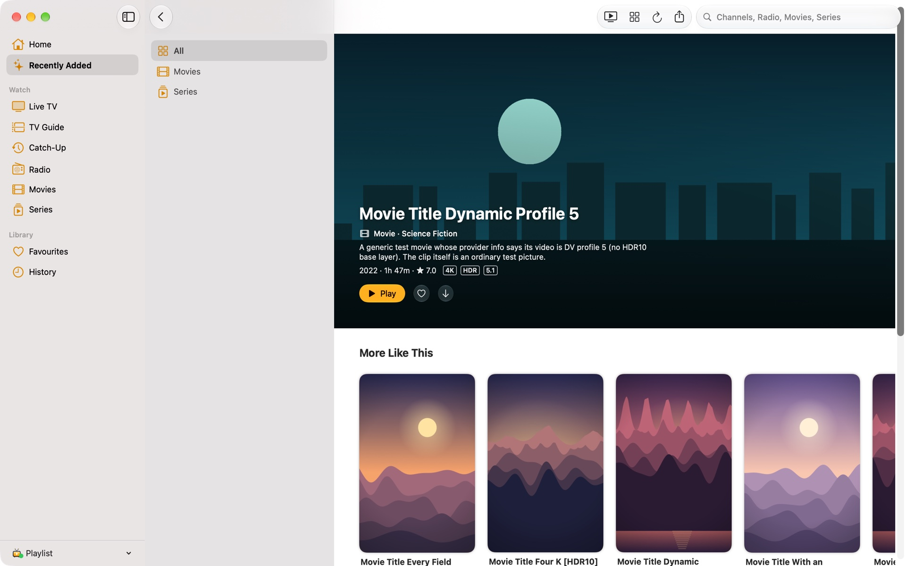
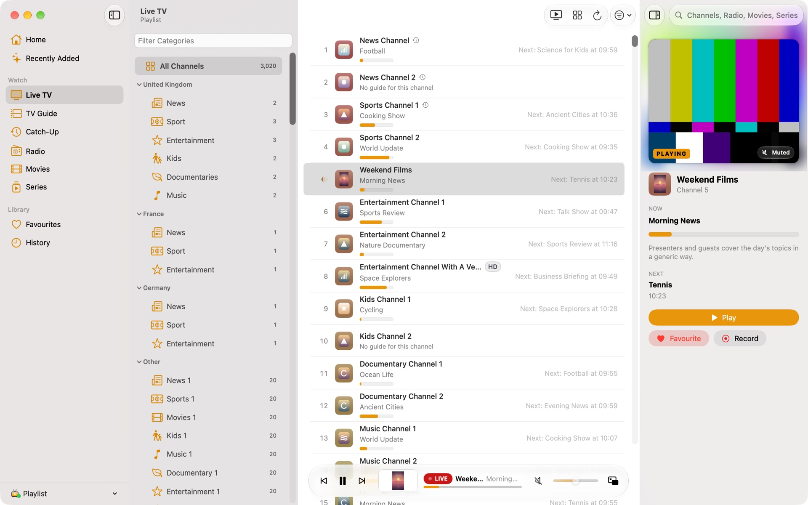
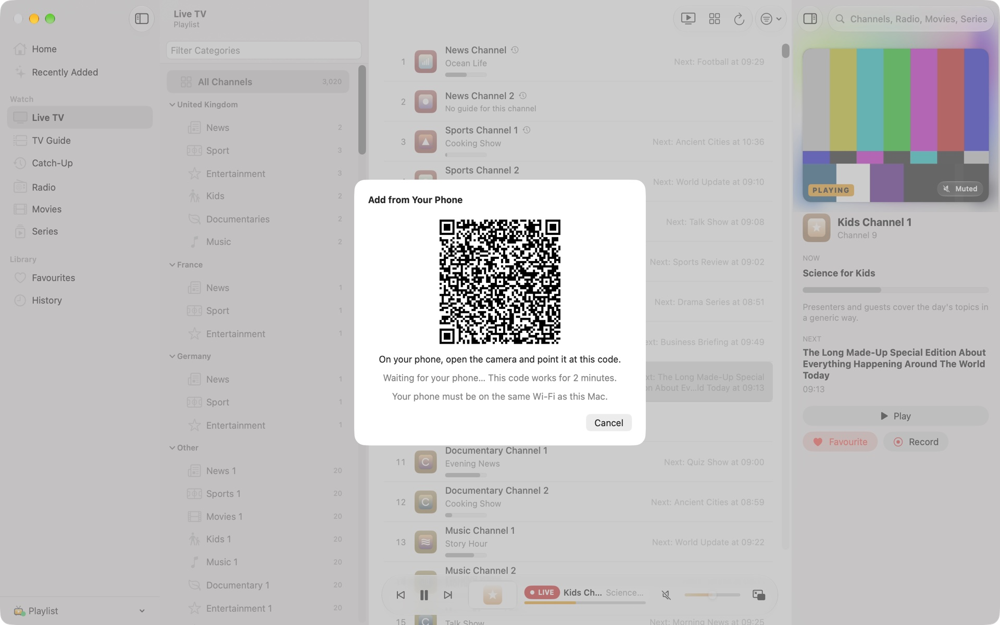

  

<h1 align="center">ElBee Player for Mac</h1>

  <strong>Live TV, the TV Guide, films, series and radio from the TV service you already have, in a native Mac app.</strong>

  <picture><source media="(prefers-color-scheme: dark)" srcset="assets/brand/elbeehq-hive-on-dark.svg"></picture>&nbsp;<picture><source media="(prefers-color-scheme: dark)" srcset="assets/brand/elbeehq-wordmark-on-dark.svg"></picture>

  
  
  
  
  
  
  

  

  <picture>
    <source media="(prefers-color-scheme: dark)" srcset="assets/screenshot-dark.jpg">
    
  </picture>

ElBee Player plays the channels, programme guide, films and series from the TV service you already subscribe to.
Sign in with your provider's server address, username and password, or add a playlist link or file. It comes with
no channels or content of its own: it's the player, and your service is the content.

It's free for personal use, with no account, no adverts and no tracking.

## Why ElBee Player

- **Made for the Mac, not ported to it.** A sidebar, an inspector, a full menu bar, keyboard shortcuts, media keys and
  Control Centre, and the system's own glass on macOS 26. What's playing keeps playing in a bar at the foot of the page
  while you browse.
- **Everything in one place.** Live TV, a week-long TV Guide, catch-up, films, series and radio, from one sign-in.
- **Your country first.** Choose a Preferred Country and its channels and titles lead every list, followed by the
  countries that share its language. Content Languages hides the rest if you want it gone altogether.
- **Private by design.** Recommendations are worked out on your Mac. Your sign-in stays in the macOS Keychain and
  goes only to your own service. Nothing about what you watch is sent to us or anyone else.

## Features

<table>
  <tr>
    <td width="50%" valign="top">
      <picture><source media="(prefers-color-scheme: dark)" srcset="assets/screenshot-guide-dark.jpg"></picture>
      <h3>Live TV and the TV Guide</h3>
      <ul>
        <li>A TV Guide a week ahead, with reminders and Record Series.</li>
        <li>Catch-up, and pause and rewind live TV, where your service offers it.</li>
        <li>Multi-View: up to four channels at once.</li>
        <li>Up Next: a heads-up a minute before something you like starts on another channel.</li>
        <li>Switch channels without leaving full screen: press ↑ or ↓, or type the channel's number.</li>
        <li>Use Another Guide: bring your own programme guide link, with automatic channel matching and Match Guide Channel… for the rest.</li>
      </ul>
    </td>
    <td width="50%" valign="top">
      <picture><source media="(prefers-color-scheme: dark)" srcset="assets/screenshot-title-dark.jpg"></picture>
      <h3>Films and series</h3>
      <ul>
        <li>A page for every title, with artwork, cast, seasons and More Like This.</li>
        <li>4K, HD, HDR, 5.1, 7.1 and Spatial Audio badges, so you know what you're getting.</li>
        <li>Spatial Audio: surround sound plays as spatial sound on your Mac.</li>
        <li>Continue Watching and Up Next pick up where you stopped.</li>
        <li>Recently Added rows for new films and series.</li>
      </ul>
    </td>
  </tr>
  <tr>
    <td width="50%" valign="top">
      <picture><source media="(prefers-color-scheme: dark)" srcset="assets/screenshot-live-dark.jpg"></picture>
      <h3>Make it yours</h3>
      <ul>
        <li>Rename Channel… and Change Logo… on any live channel, from a link or a picture.</li>
        <li>Manage Categories: hide them, set their country, or hide a whole region at once.</li>
        <li>Put Home's rows in your own order, and hide the ones you don't use.</li>
        <li>Play In: open live TV, films or series in another player app on your Mac if you prefer.</li>
        <li>Parental controls, with Touch ID to unlock, and age ratings for films.</li>
      </ul>
    </td>
    <td width="50%" valign="top">
      <picture><source media="(prefers-color-scheme: dark)" srcset="assets/screenshot-phone-dark.jpg"></picture>
      <h3>Around your home</h3>
      <ul>
        <li>Add from Your Phone: scan a code with ElBee Player for Android and the playlist arrives, encrypted, with no typing.</li>
        <li>Send to Another Device…: send a playlist to your TV or another Mac in the same way.</li>
        <li>Cast to the TVs and speakers on your network.</li>
        <li>A floating video window that stays on top while you work.</li>
        <li>Back Up Settings…: keep your playlists, favourites and settings in one file, with your sign-in protected by a passphrase, and restore them on another Mac.</li>
      </ul>
    </td>
  </tr>
</table>

## Download and install

1. Download the disk image from the [latest release](https://github.com/ElBeeHQ/ElBeePlayer/releases/latest) or
   [elbeehq.com/mac](https://elbeehq.com/mac).
2. Open it and drag **ElBee Player** onto **Applications**.
3. Allow it once. ElBee Player isn't notarised by Apple, so the first time you open it macOS asks you to confirm: open
   **System Settings › Privacy & Security** and click **Open Anyway**. The
   [step-by-step guide](https://elbeehq.com/support#install) has pictures.

Needs macOS 15 or later on Apple silicon or Intel, and your own TV service.

## Getting started

1. **Add your service.** Choose Server Sign-In and enter the server address, username and password your provider gave
   you, or add a playlist link or file. Already have it on your Android phone? Choose **File › Add from Your Phone…**
   and scan the code instead.
2. **Choose your languages and country.** ElBee Player asks which languages you watch in and, if your playlist covers
   several countries, which one should come first.
3. **Watch.** Home shows what's new, what's on now and what you were watching. Everything else is in the sidebar.

## Updates

ElBee Player updates itself from this page. Each update is checked against ElBee Player's own signing key before it's
installed, and your playlists and settings are kept. You can turn automatic checks off in **Settings › General ›
Updates**. Every change is listed in [What's New](CHANGELOG.md).

## Also from ElBeeHQ

- [**ElBee Player for Android**](https://elbeehq.com/android): phones, tablets, Android TV, Google TV and Fire TV,
  with the same Preferred Country and send-to-another-device features.
- [**ElBee Stats**](https://elbeehq.com/stats/): download statistics for your own GitHub releases, on your Mac.

## Links

[What's New](CHANGELOG.md) · [Help](https://elbeehq.com/support) · [Report a problem](https://github.com/ElBeeHQ/ElBeePlayer/issues) ·
[Privacy](https://elbeehq.com/privacy) · [Legal & Terms](https://elbeehq.com/legal) · [elbeehq.com](https://elbeehq.com)

ElBee Player is a media player only. It includes no channels, films or other content; use it only with services
and media you have the right to use. ElBeeHQ is not affiliated with, endorsed by or sponsored by any broadcaster,
content owner, TV service, Apple, GitHub, VideoLAN, the FFmpeg project or Sparkle. Mac and macOS are trademarks of
Apple Inc. GitHub is a trademark of GitHub, Inc. Android is a trademark of Google LLC. Other names belong to their
owners and are used only to describe compatibility.

© 2026 ElBeeHQ. Free for personal, non-commercial use; see [LICENSE](LICENSE). Versions up to 0.10.01 were
released under the GNU General Public License, version 3. ElBee Player includes VLCKit and FFmpeg (LGPL 2.1 or later,
unmodified, as separate frameworks you can replace) and Sparkle (MIT); their licences are in
[licenses/](licenses/) and in the app.
